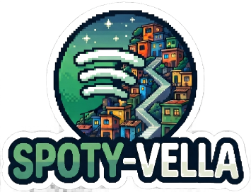

<a href="https://www.navidrome.org"></a>

# Spoty-Vella -  O Spotify da Favela!
[](https://github.com/alanmugiwara/spoty-vella)
[](https://github.com/navidrome/navidrome)
[](https://github.com/alanmugiwara/spoty-vella?tab=GPL-3.0-1-ov-file)
[](https://github.com/alanmugiwara/spoty-vella)
[](https://github.com/alanmugiwara/spoty-vella)
[](https://github.com/alanmugiwara/spoty-vella)
[](https://github.com/alanmugiwara/spoty-vella)
[](https://github.com/alanmugiwara/spoty-vella)
[](https://github.com/alanmugiwara/spoty-vella)
[](https://hub.docker.com/r/alanmugiwara/spoty-vella)

# Um Spotify self-hosted para sua coleção musical!

Spoty-Vella é uma distribuição customizada do [Navidrome](https://github.com/navidrome/navidrome): escaneia sua biblioteca de músicas, serve tudo via protocolo Subsonic, e entrega uma interface web moderna para navegar, ouvir, criar playlists, gerenciar favoritos e tudo isso sem instalar nada no cliente, rodando direto pelo navegador ou por qualquer app compatível com Subsonic. Como o [Musly](https://github.com/dddevid/musly), o qual recomendo utilizar, pois além de ser funcionar e capricar na estética possui versões pra diversas arquiteturas

O nome é uma brincadeira com "Spotify" e "Favela" - uma homenagem bem-humorada à experiência de ter seu próprio streaming pessoal, sem algoritmos, sem anúncios e sem assinar nada. Sua música, do seu jeito, no seu próprio servidor.

Mais do que uma customização do Navidrome, o Spoty-Vella é uma forma de resgatar o prazer de ter uma coleção musical de forma organizada, com capas, letras, scrobbles já definidos. Tudo isso com o mínimo de configuração possível.

---

## Funcionalidades

- **Biblioteca organizada:** escaneia automaticamente sua pasta de músicas e organiza por artista, álbum e gênero.

- **Protocolo Subsonic:** compatível com diversos apps para Android, iOS, desktop e CLI.

- **Interface web moderna:** built com React + Material UI, com suporte a PWA para instalar como app.

- **Temas visuais:** vários temas incluídos - Dracula, Nord, Tokyo Night, Rose Piné, Catppuccin, Monokai, Spotify e mais.

- **Agentes ativos por padrão:** os agentes de metadados (`artist-nfo-metadata`, `apple-music`, `coverartarchive`, `deezer`, `lastfm`) já vêm pré-configurados no `.env`, sem necessidade de configuraçãoa adiconal além das credenciais nessesárias.

- **Reload de plugins sem reboot:** o reload automático de plugins está habilitado por padrão - atualizações e novos plugins são carregados sem derrubar a aplicação, preservando sessões, serviços e agentes já em execução.

- **Scrobbling:** integração nativa com Last.fm e ListenBrainz para registrar o que você ouve. (Não esqueça de por as suas credenciais de API)

- **Metadados ricos:** leitura de tags dos arquivos (ID3, FLAC, etc.) via TagLib.

- **Multi-usuário:** sistema de autenticação com diferentes níveis de permissão e suporte a OIDC.

- **Transcodificação:** converte formatos de áudio on-the-fly via FFmpeg.

- **Pronto para Docker:** imagem publicada no Docker Hub, configuração por variáveis de ambiente.

---

## Stack

- [Navidrome](https://github.com/navidrome/navidrome) - base do projeto (servidor de música Subsonic)

- [Go 1.27](https://go.dev/) - backend

- [React 17](https://react.dev/) + [Vite](https://vitejs.dev/) - frontend

- [SQLite](https://www.sqlite.org/) - banco de dados embarcado dentro do container

- [FFmpeg](https://ffmpeg.org/) - transcodificação de áudio

- [TagLib](https://taglib.org/) - leitura de metadados dos arquivos

- [Docker](https://www.docker.com/) ou [Podman](https://podman.io/) - empacotamento e deploy

---

## Deploy rápido com Docker Compose ou Podman Compose

### 1. Baixe o projeto e entre no diretório de trabalho

```bash
git clone https://github.com/alanmugiwara/spoty-vella && \
cd spoty-vella/app
```

### 2. Configure suas variáveis de ambiente

Renomeie o `.env.exemple` para `.env` e edite-o com suas credenciais:

```env
HOST_DATA=/caminho/para/os/dados/do/navidrome
HOST_MUSIC=/caminho/para/seu/diretorio/de/musicas
ND_AGENTS=artist-nfo-metadata,apple-music,coverartarchive,deezer,lastfm
LASTFM_APIKEY=sua-api-key-lastfm
LASTFM_SECRET=seu-secret-lastfm
```

> **`ND_AGENTS` preenchido** com agentes de metadados ativos. O reload de plugins também está habilitado por padrão, então qualquer atualização ou adição de plugin é carregada automaticamente - sem precisar reiniciar a aplicação nem reconfigurar serviços já em execução.

### 3. Rode o script abaixo para criar os diretórios de trabalho

```bash
bash create_work_dirs.sh
```

> O script lê as variáveis do `.env` e cria os diretórios `HOST_DATA`, `HOST_DATA/plugins` e `HOST_MUSIC` com as permissões corretas. O subdiretório `plugins/` é onde os arquivos `.ndp` devem ficar para serem carregados automaticamente.

### 4. Baixe os plugins necessários para os serviços necessários funcionarem

```bash
bash download_plugins.sh
```

> O script detecta automaticamente o caminho `HOST_DATA/plugins` do `.env` e o sugere como destino - basta dar `Enter` para confirmar. Caso o script não leia o `.env`, digite o caminho manualmente.

Plugins baixados:

| Plugin | Repositório |
|---|---|
| `apple-music.ndp` (Capas e infomações de músicas e discos) | [navidrome/apple-music-plugin](https://github.com/navidrome/apple-music-plugin) |
| `artist-nfo-metadata.ndp` (Dados de artistas) | [metalheim/navidrome-plugin-artist-nfo-metadata](https://github.com/metalheim/navidrome-plugin-artist-nfo-metadata) |
| `coverartarchive.ndp` (Capas e infomações de músicas e discos)| [sunsetroute1/navidrome-coverartarchive-plugin](https://github.com/sunsetroute1/navidrome-coverartarchive-plugin) |
| `nd-lyrics.ndp` (Letras de músicas) | [J0R6IT0/navidrome-lyrics-plugin](https://github.com/J0R6IT0/navidrome-lyrics-plugin) |

> O reload automático de plugins está ativo por padrão. Os `.ndp` são carregados sem precisar reiniciar os containers.

### 5. Suba os containers para executar a aplicação

```bash
docker compose up -d
```

```bash
podman-compose up -d
```

A interface estará disponível em `http://localhost:4533`.

> No primeiro acesso, crie o usuário administrador pela própria interface web.

---

## Imagem Docker

A imagem está publicada no Docker Hub:

[](https://hub.docker.com/r/alanmugiwara/spoty-vella)

---

## Estrutura de volumes

| Volume | Descrição |
|---|---|
| `$HOST_DATA` | Banco de dados SQLite, plugins e configurações do Navidrome |
| `$HOST_MUSIC` | Sua biblioteca de músicas (bind-mount) |

---

## Apps compatíveis (Subsonic)

Por usar o protocolo Subsonic, o Spoty-Vella funciona com qualquer app que o suporte:

- **Android:** Substreamer, Symfonium, DSub, Ultrasonic
- **iOS:** Substreamer, Amperfy, play:Sub
- **Desktop:** Sublime Music, Sonixd, Feishin
- **CLI:** `beets`, `mopidy-subidy`
- **Android, iOS, Windows, Linux, MacOS:** [Musly](https://github.com/dddevid/musly)

---

## Temas disponíveis

- Dracula
- Nord
- Tokyo Night / Tokyo Night Light
- Rose Piné / Rose Piné Dawn / Rose Piné Moon
- Catppuccin Latte / Frappé / Macchiato / Mocha
- Monokai
- Gruvbox Dark
- Spotify
- Electric Purple
- Moonbase Alpha / Bravo
- Dark / Light / Extra Dark
- E mais...

---

## Building e criação da sua própria imagem

Clone este repositório e entre no caminho do projeto:

``` bash
git clone https://github.com/alanmugiwara/spoty-vella \
  && cd spoty-vella
```

Build da imagem multiarch e upload para o seu Docker Hub:

```bash
docker buildx build \
  --no-cache \
  --platform linux/amd64,linux/arm64 \
  --target final \
  --tag SEU-USUARIO/NOME-DO-SEU-PROJETO:VERSAO \
  --file Dockerfile \
  --push \  
  .
```

> Se você quer apenas buildar localmente para testar com docker compose, faça para a arquitetura da sua máquina, pois o `--load` não funciona com `--platform linux/amd64,linux/arm64` para carregar um manifest multiarch no Docker local.

Suba os containers:

```bash
docker compose up -d
```

Building e execução local (AMD64):

```bash
docker buildx build \
  --no-cache \
  --platform linux/amd64 \
  --target final \
  --tag alanmugiwara/spoty-vella:v0.2 \
  --file Dockerfile \
  --load \
  .
```
- Navegue até o diretório `app` e suba o container
``` bash
cd app && docker compose up -d
```

Building e execução local (ARM64):

```bash
docker buildx build \
  --no-cache \
  --platform linux/arm64 \
  --target final \
  --tag alanmugiwara/spoty-vella:v0.2 \
  --file Dockerfile \
  --load \
  .
```

- Navegue atéa o diretório `app` e suba o container
``` bash
cd app && docker compose up -d
```

---

## Ambiente de desenvolvimento
Caso queira rodar locamelmente sem uso de conteinerização

- Dependências necessárias: [GoLang 1.26+](https://go.dev/doc/install) | [Node 24](https://nodejs.org/)

Instale as dependências e prepare o ambiente:

```bash
make setup
```

Rode o Spoty-Vella em modo desenvolvimento com hot-reload (frontend + backend):

```bash
make dev
```

A interface estará disponível em `http://localhost:4533`.

> Para editar o frontend, mexa nos arquivos em `ui/src/`. As mudanças são refletidas automaticamente no navegador. Consulte a [documentação de desenvolvimento](https://www.navidrome.org/docs/developers/dev-environment/) para mais detalhes.

---

## Contato

<div>
  <a href="https://instagram.com/alancruz_tec" target="_blank"></a>
  <a href="mailto:contato@alancruztec.com.br"></a>
  <a href="https://linkedin.com/in/alansilvadacruz" target="_blank"></a>
  <a href="https://alancruztec.com.br" target="_blank"></a>
</div>

---

## Licença

Este projeto é licenciado sob a [AGPL-3.0 License](https://github.com/alanmugiwara/spoty-vella?tab=GPL-3.0-1-ov-file).

Spoty-Vella é um fork do [Navidrome](https://github.com/navidrome/navidrome), que também é distribuído sob AGPL-3.0.
